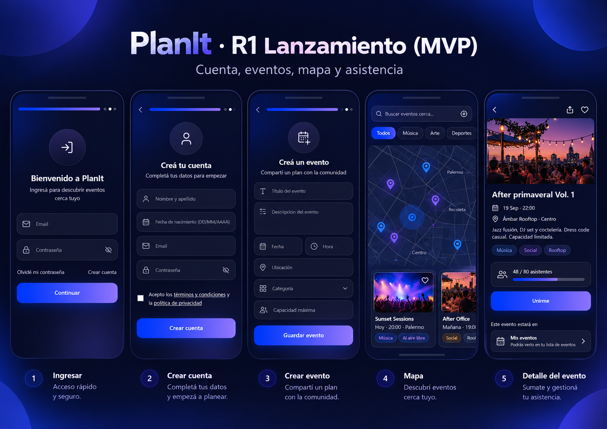
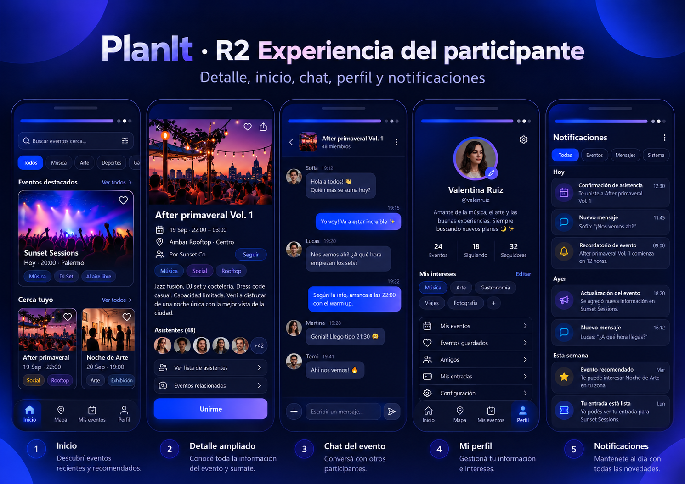
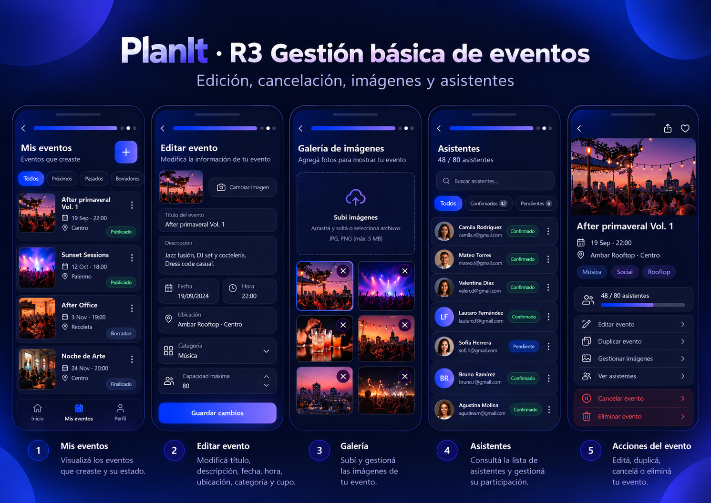
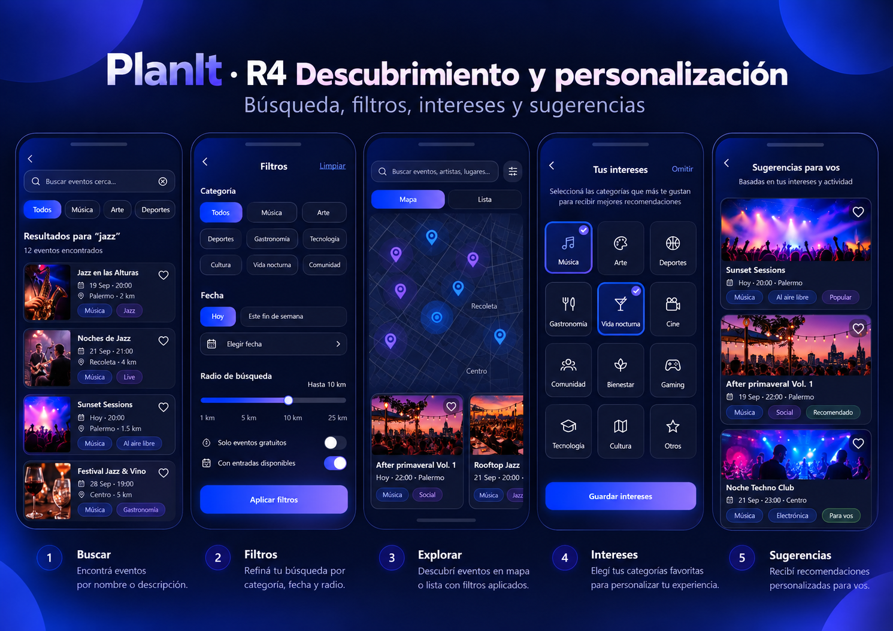
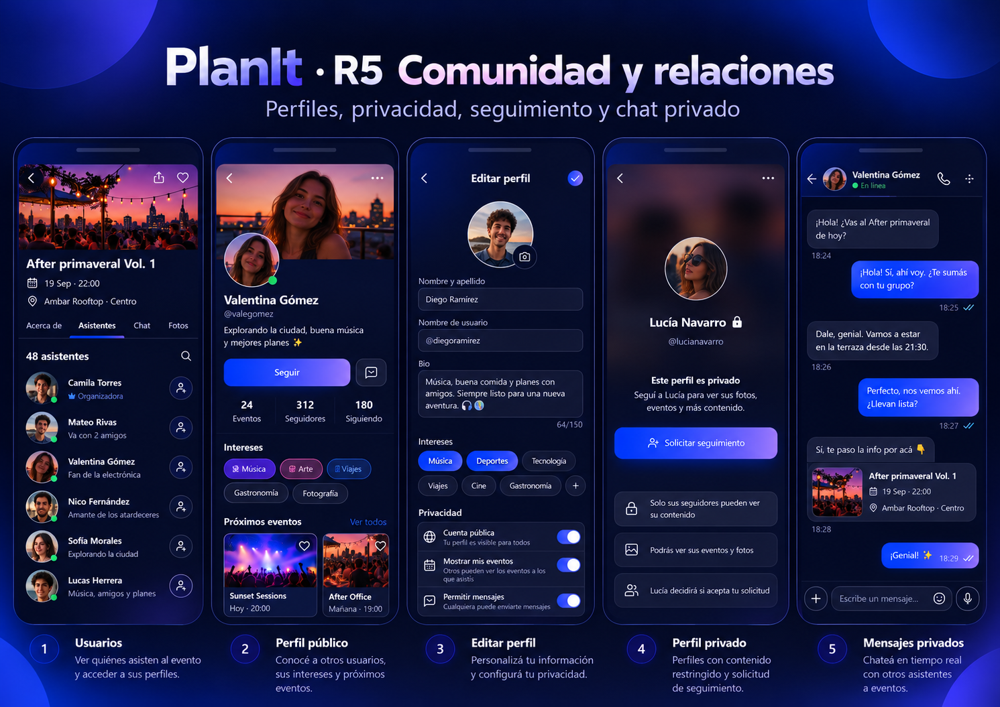
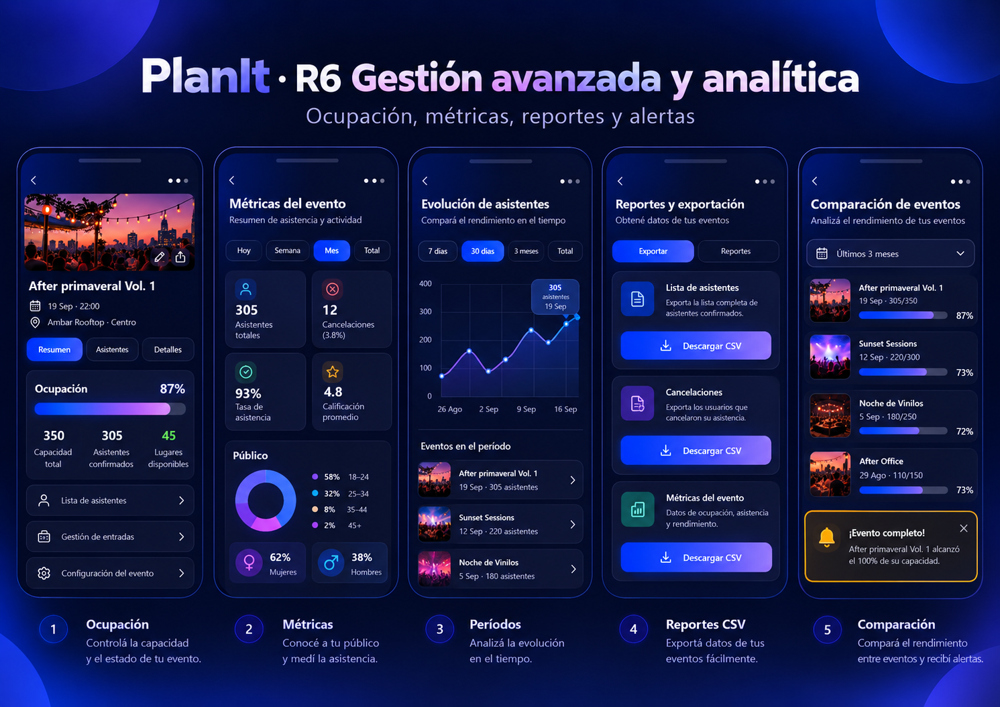
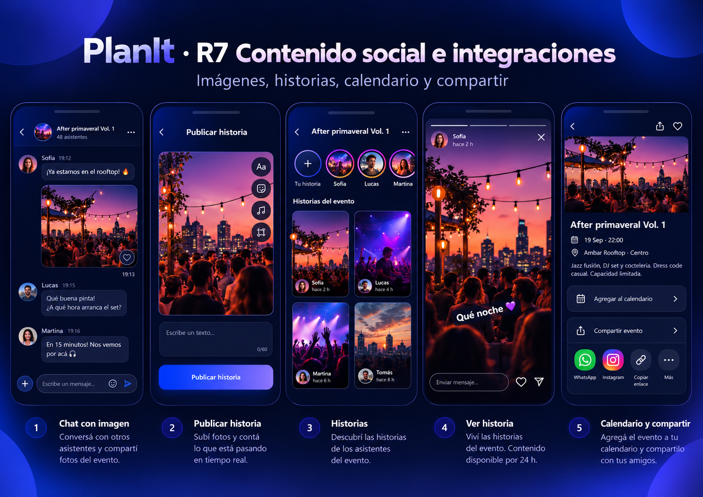

# PlanIt — Catálogo visual de pantallas por release

> **Apariencia histórica — 12/10/2026.** Las descripciones visuales de este catálogo (fondo marino oscuro, inputs oscuros, CTA degradado, halos) corresponden a los mockups originales y **no son el objetivo visual**: la dirección vigente es **B · Amanecer** ([DESIGN.md](../../DESIGN.md), [decisión](proposals/amanecer-direction.md)). El catálogo sigue siendo válido como inventario de pantallas, rutas y funciones por release.

**Referencias**: `mockups/release-1.png` a `mockups/release-7.png`. Cada PNG contiene cinco pantallas representativas de una release; los números bajo las pantallas se refieren al collage, no a rutas de la PWA. Estas fichas describen sólo lo visible en los mockups; los campos/acciones no visibles se definen por RF y arquitectura.

## Release 1 — Lanzamiento (MVP)

| # | Pantalla del mockup | Características visuales que deben preservarse | Ruta web propuesta / RF |
| --- | --- | --- | --- |
| 1 | **Ingresar** | Fondo marino profundo, línea/acento azul-violeta arriba, ícono circular grande de ingreso, título centrado, dos inputs oscuros con iconos, mostrar/ocultar contraseña, links secundarios y CTA degradado ancho completo | `/login`; RF-R1-02 |
| 2 | **Crear cuenta** | Ícono circular usuario, título/subtítulo centrados, formulario vertical con campos oscuros, checkbox de términos ilustrativo, CTA degradado inferior | `/register`; RF-R1-01 |
| 3 | **Crear evento** | Icono calendario en círculo, título, formulario de entrada denso en columna, fecha/hora alineadas en fila, selector de categoría, capacidad, CTA grande | `/events/new`; RF-R1-03 |
| 4 | **Mapa** | Búsqueda y chips en la parte alta, mapa oscuro con marcadores azules y violetas, pequeño radar/halo de ubicación, tarjetas de eventos en zona inferior | `/map`; RF-R1-04 |
| 5 | **Detalle del evento** | Hero de foto grande, título, íconos de fecha/lugar, etiquetas, resumen de asistentes n/capacidad con barra, gran CTA de unirse, enlace a Mis eventos | `/events/:id`; RF-R1-05/06 |

**Notas de implementación R1:**
- Registro exige correo, contraseña y `display_name` (2–60), no requiere fecha de nacimiento. El mockup muestra fecha de nacimiento, pero en el modelo es opcional y no debe bloquear RF-R1-01. Términos: sólo exigir consentimiento si fue aprobado jurídicamente/funcionalmente; no inventar un campo de BD.
- Crear evento requiere `starts_at` y `ends_at` aunque el mockup simplifique a «Fecha / Hora»: incorporar fin usando la misma estética. También requiere ubicación geográfica y coordenadas, dirección, descripción, categoría única y cupo > 0.
- La búsqueda avanzada, las categorías múltiples como filtro y favoritos pueden verse como inspiración, pero en R1 sólo hay exploración geográfica pública básica; no simular filtros funcionales R4.
- Se necesita una vista de detalle mínima para inscribirse y retirarse. «Unirme» cambia según estado real; no duplicar inscripción.
- Si se usan fotografías en la creación de eventos R1, respetar el límite aprobado (hasta 10) y permisos; no omitir en silencio el alcance de RF-R1-03.
- El diseño oscuro de móvil **no** debe conservar la página de presentación beige/verde producida provisionalmente en el bloque 0.

## Release 2 — Experiencia del participante

| # | Pantalla | Referencias visuales | RF principal |
| --- | --- | --- | --- |
| 1 | **Inicio** | Barra de búsqueda, chips, secciones «Eventos destacados» / «Cerca tuyo», tarjetas con foto y chips, navegación inferior | R2-02/R2-03 |
| 2 | **Detalle ampliado** | Hero amplio, fecha y lugar, organizador, categoría, descripción, fila de avatares de asistentes, enlaces a asistentes y eventos relacionados, CTA inferior | R2-01 |
| 3 | **Chat de evento** | Header con imagen/miembros, mensajes entrantes oscuros y salientes azul-violeta, timestamps, avatars, composer inferior | R2-04/R2-05 |
| 4 | **Mi perfil** | Avatar circular destacado, username, biografía, contadores, chips intereses, menu de acciones, bottom nav con Perfil activo | R2-06 |
| 5 | **Notificaciones** | Lista agrupada por fecha, iconos circulares por tipo, chips de filtro, filas elevadas y marcas horarias | R2-07 |

Notas: Los mockups muestran acciones `Seguir`, filtros de notificaciones, contadores y datos sociales; su implementación dependerá de releases correspondientes. Un chat de evento es únicamente de organizador + inscriptos confirmados.

## Release 3 — Gestión básica de eventos

| # | Pantalla | Referencias visuales | RF principal |
| --- | --- | --- | --- |
| 1 | **Mis eventos — gestión** | Título y botón agregar, chips Todos/Próximos/Pasados, filas con miniaturas, fecha, estado y menú | R3-04 |
| 2 | **Editar evento** | Formulario vertical con imagen de portada, bloques de título/descripción, date/time, ubicación, categoría y cupo | R3-01 |
| 3 | **Galería** | Zona punteada de subir, cuadrícula 2 columnas, miniaturas con botón X, CTA de carga | R3-03 |
| 4 | **Asistentes** | Buscador, chips por estado, lista de avatars, nombres, estados y menú por persona | R3-05/R3-06 |
| 5 | **Acciones del evento** | Hero del evento y menú vertical de editar, duplicar, imágenes, asistentes; zona de peligro con cancelar y eliminar | R3-02/R3-07 |

Notas: El chip `Borradores` ilustra algo **no persistido** por decisión aprobada. No agregar un estado `draft` ni lista remota de borradores. «Eliminar evento» equivale a **archivar**, no ejecutar DELETE. El estado `pending` dibujado para asistentes **no es** un estado de inscripción común; la inscripción es directa (`confirmed`) y la espera de reingreso reside en `event_rejoin_requests`.

## Release 4 — Descubrimiento y personalización

| # | Pantalla | Referencias visuales | RF principal |
| --- | --- | --- | --- |
| 1 | **Buscar** | Input superior, chips, resultados verticales con foto lateral, título, fecha/lugar, badges | R4-01/R4-02 |
| 2 | **Filtros** | Chips por categoría, botones de fecha, slider de radio y CTA Aplicar filtros | R4-02/R4-03/R4-04 |
| 3 | **Explorar** | Toggle Mapa/Lista, mapa de marcadores, tarjetas superpuestas abajo | R4 |
| 4 | **Intereses** | Grid de tarjetas icono+nombre, borde y check azul seleccionadas, CTA Guardar intereses | R4-05 |
| 5 | **Sugerencias** | Lista de cards con hero y badges personalizados | R4-06 |

Notas: El chip `Solo eventos gratuitos`, entradas disponibles, filtros por precio, favoritos y ratings no cuentan con contrato funcional o modelo de datos confirmado: no agregarlos sin actualizar requisitos y esquema. Un evento tiene **una** categoría; el usuario puede tener **varios** intereses y puede filtrar por varias categorías en R4.

## Release 5 — Comunidad y relaciones

| # | Pantalla | Referencias visuales | RF principal |
| --- | --- | --- | --- |
| 1 | **Usuarios/asistentes** | Hero evento, tabs Acerca de/Asistentes/Chat/Fotos, lista con avatars redondos y acciones seguir | R5-01 |
| 2 | **Perfil público** | Cover fotográfica, avatar superpuesto, nombre, username, bio, CTA Seguir, contadores, chips intereses y mini tarjetas de eventos | R5-02/R5-05 |
| 3 | **Editar perfil** | Avatar, inputs nombre/username/bio, intereses seleccionables y privacidad | R5-03 |
| 4 | **Perfil privado** | Fondo oscuro/desenfocado, avatar, candado, CTA solicitar seguimiento, tarjetas informativas de privacidad | R5-04/R5-06 |
| 5 | **Mensajes privados** | Header con avatar, conversación de dos personas, burbujas alineadas, composer inferior; tarjeta compartida de evento | R5-07 |

Notas: Los mockups muestran switches `Mostrar mis eventos` y `Permitir mensajes`, no definidos en `profiles` aprobado. No crear nuevas columnas/políticas sin confirmar. Los perfiles privados conservan nombre/username/avatar públicos; la lectura de contenido ampliado requiere autorización. Bloquear conserva historial de DM y afecta interacciones directas, nunca chat de evento. Audio/micrófono y estados de lectura no están aprobados.

## Release 6 — Gestión avanzada y analítica

| # | Pantalla | Referencias visuales | RF principal |
| --- | --- | --- | --- |
| 1 | **Ocupación** | Hero evento, tabs, barra azul-violeta y números de capacidad/confirmados/disponibles | R6-01 |
| 2 | **Métricas** | Cards numéricas en cuadrícula, variaciones, donut demográfico y badges | R6-02 |
| 3 | **Evolución** | Filtros por período y línea temporal con área coloreada | R6-03 |
| 4 | **Reportes/CSV** | Tarjetas de exportación con iconos y CTA degradados | R6-04 |
| 5 | **Comparación** | Lista de eventos con barras relativas de ocupación y aviso resaltado de cupo completo | R6-05/R6-06 |

Notas: `Calificación promedio` y `tasa de asistencia real` podrían requerir reseñas/check-ins que no están modelados. No inventar métricas ni almacenar datos inexistentes. Las estadísticas demográficas deben ser agregadas, no exponer datos individuales. No crear ticketing.

## Release 7 — Contenido social e integraciones

| # | Pantalla | Referencias visuales | RF principal |
| --- | --- | --- | --- |
| 1 | **Chat con imagen** | Composer inferior e imagen grande adjunta, burbujas/avatars sobre fondo oscuro | R7-01 |
| 2 | **Publicar historia** | Vista de foto vertical, herramientas laterales ilustrativas, CTA inferior | R7-02 |
| 3 | **Historias del evento** | Avatars circulares con aro color, grid 2 columnas de historias con imagen/autor/antigüedad | R7-03 |
| 4 | **Ver historia** | Foto full-screen, overlay superior de autor y barra temporal, cierre y acciones inferiores | R7-04 |
| 5 | **Calendario y compartir** | Hero evento, filas de calendario/share y accesos de compartir en apps | R7-05/R7-06 |

Notas: historias aprobadas = una imagen por historia, expiran a 24 h. Música, stickers, herramientas avanzadas, reacción/corazones y respuesta directa del visor son ilustrativos y no pertenecen automáticamente al alcance. Máximo una imagen por mensaje de evento; DM sólo texto. Web Push se integra por otro flujo visual sin mockup propio en esta lámina.

## Guía de implementación incremental

- **R1:** copiar la identidad visual y la jerarquía de las 5 pantallas R1; introducir navegación sólo acorde con RF activos y campos extra obligatorios del esquema.
- **R2 en adelante:** extraer patrones repetidos del diseño R1 (chips, cards, gradient CTA, header, bottom nav, forms) para aumentar consistencia.
- No reconstruir literalmente cada pantalla del poster usando proporciones de píxeles del collage. En una PWA real, usar CSS responsive y controles accesibles.
- Para referencias cruzadas de decisiones ambiguas, consultar `DESIGN_GAPS.md`.
