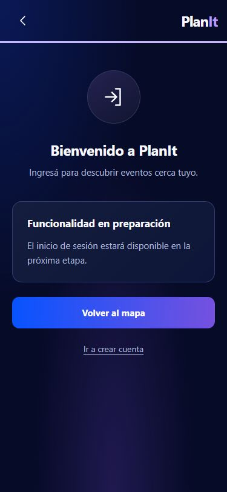
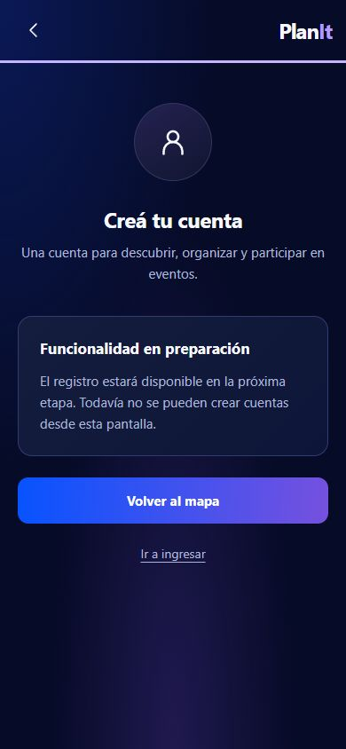
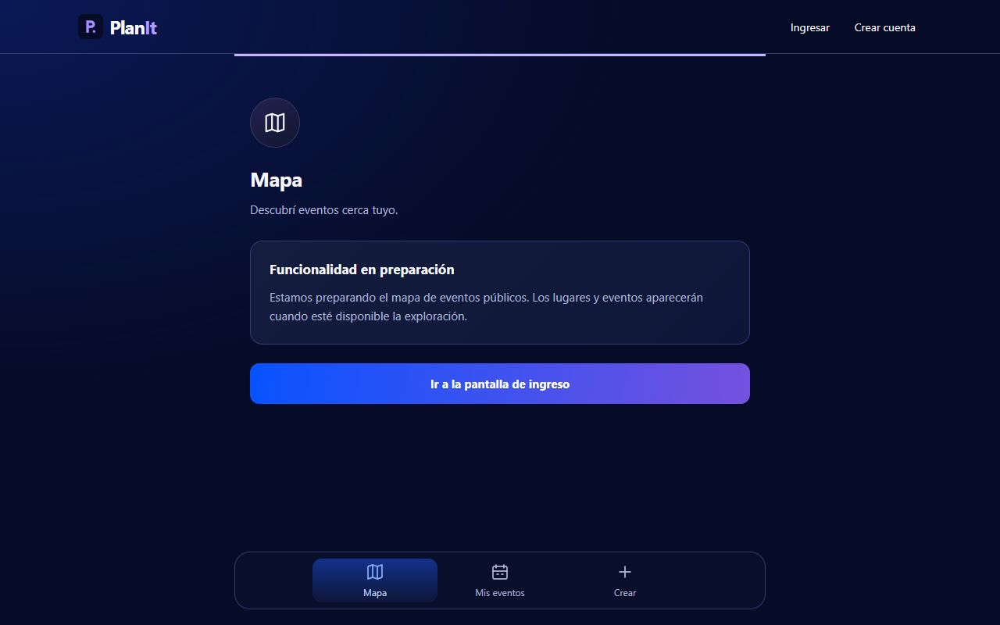

# Adaptación visual del BLOQUE 0

Fecha: 10/10/2026 (Argentina). Rama: `codex/block-0-foundation`.

## Alcance y comparación

Se revisaron AGENTS raíz/frontend/diseño y todos los Markdown del contrato de diseño. Se abrieron visualmente R1/R2. Se recuperan fondos marino, superficies con borde tenue, iconos lineales circulares, títulos compactos y CTA azul/violeta. Login y registro usan composición centrada dedicada, sin navegación ni footer promocional. Las otras rutas tienen navegación inferior Mapa/Mis eventos/Crear, reducida a destinos existentes respecto de R2. Escritorio mantiene ancho legible sin marco de teléfono.

Las referencias R1 muestran formularios, mapa y fotografías. Este bloque muestra avisos auténticos de preparación y enlaces de navegación, sin simular esos controles ni datos. No se copian fotos ni decoración del póster. Se conservan las rutas, 404, redirección inicial y foco al cambiar de ruta. El trazo lila superior visible en algunas capturas es el indicador de foco del contenido, no progreso.

## Diferencias por archivo

| Archivo | Cambio |
| --- | --- |
| `src/index.css` | Tokens estimados marino/azul/violeta, superficies, radios, escala de control 52 px, foco y controles nativos oscuros |
| `src/App.css` | Mobile-first, auth centrada, encabezado compacto, tarjetas de estado, CTA, safe-area y navegación inferior con adaptación desktop |
| `src/components/AppLayout.tsx` | Layout dedicado de auth; enlaces de cuenta compactos y navegación inferior sólo con rutas existentes; sin footer promocional |
| `src/components/Icon.tsx` | Seis SVG lineales decorativos propios, sin paquete adicional |
| `src/components/ScreenHeader.tsx` | Encabezado compartido con icono, título y descripción |
| `src/pages/FoundationPage.tsx` | Títulos de producto y estados pendientes, sin panel de marketing ni formularios inertes |
| `index.html` | Theme color marino y viewport-fit=cover |
| `vite.config.ts` | Sólo theme_color/background_color del manifest; validaciones y política SW intactas |
| `public/favicon.svg`, `public/icons/*.png`, `scripts/generate-icons.py` | Recoloración marino/lila conservando geometría, tamaños, RGB opaco y zona segura |
| `docs/design/DESIGN_GAPS.md` | Excepciones visuales de foundation y ajuste estimado de contraste |

`src/App.tsx`, `src/lib/*`, SQL y migraciones no se modificaron. No se instalaron dependencias. `src/AGENTS.md`, `.agents/`, `skills-lock.json` y la carpeta de diseño ya tenían cambios antes de esta tarea.

## Verificación

- `npm run build`: exit 0; TypeScript/Vite y generación PWA completados, 13 entradas de precache.
- `npm run lint`: exit 0, sin diagnósticos.
- `npm run check:foundation`: exit 0. PASS de validaciones planit-v2/publishable sin eco de claves; manifest, dimensiones/opacidad PNG, precache y registro SW.
- `git diff --check`: sin errores de whitespace (Git avisa conversión LF/CRLF).
- Navegador real contra producción local. Capturas JPEG de login, register, map, events/new, my-events, events/test-id y missing-page a 375×812, 390×844 y 1280×800. Datos en `measurements.json`.
- 21/21 vistas sin overflow horizontal; enlaces visibles de al menos 44×44 CSS px. El CTA mide 52 px de alto. No existen inputs ni formularios.
- Clicks reales: Mapa → Mis eventos → Crear → Ingresar → Crear cuenta. Foco del contenido al navegar y foco visible en CTA con Tab. Consola sin warnings/errors durante el recorrido.
- `/` redirige a `/map`. Prueba adicional a 390×460: con Tab, el CTA queda por encima de la navegación (borde inferior 348.30 px frente a nav desde 387 px). Se corrigió una superposición mediante scroll-padding-bottom; evidencia en `map-focus-390x460.jpg`. Esta reducción de altura prueba scroll/foco, no equivale a un teclado virtual real.
- Contraste calculado: blanco sobre extremos del CTA 5.69:1 y 5.23:1; texto secundario sobre field 8.25:1 y fondo 9.72:1. El violeta estimado original daba 3.88:1 con blanco, por lo que el CTA termina en #7651DF. Hover conserva colores y añade borde interior.

## Límites y TODO del bloque 1

- Registro/login reales, validaciones, errores/loading, sesión y protección de rutas siguen pendientes. No hay acciones que guarden o autentiquen.
- Teclado virtual: no se puede probar interacción con campos porque este bloque no tiene campos editables. Probar en dispositivo con los formularios reales del bloque 1. Safe-area se integra en CSS, pero no se validó un dispositivo físico con notch.
- El siguiente bloque debe usar etiquetas accesibles y autocomplete; registro sin birth_date obligatorio; probar submit, errores, foco y teclado virtual. Extraer FormField/PasswordField al tener uso real.
- CRUD, mapa real, fotografías y participación quedan para sus bloques correspondientes. No se construye EventCard sin eventos ni GradientButton sin acciones de botón reales.
- No se verificó instalación PWA en dispositivo ni sesión real. El check local cubre los artefactos, sin consultar ni modificar la BD.

## Capturas principales

