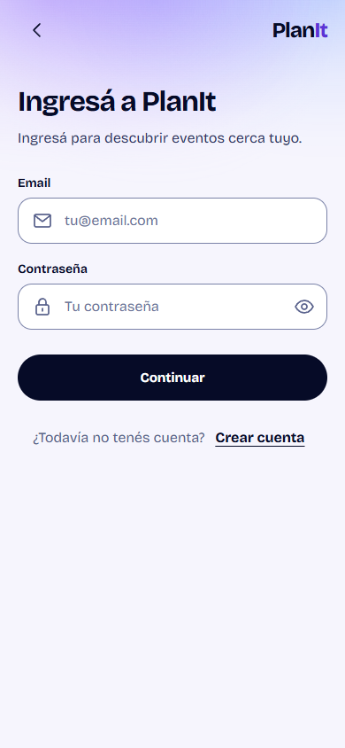

# Bloque 2 — Login y Registro con Amanecer

12/10/2026. Rama `design/ui-refresh-auth`, base origin/main `3552d4e` (Foundation PR #28 integrada). UI/UX de `/login` y `/register`; no migra otras rutas ni cambia lógica Auth/Supabase. Cambio local previo de vite.config.ts preservado y excluido del commit/PR.

## Comparación visual (fixtures, Edge)

| Pantalla a 390×844 | Antes | Amanecer |
| --- | --- | --- |
| Login | [captura](before/login-initial-390x844.png) | [captura](after/login-initial-390x844.png) |
| Registro | [captura](before/register-initial-390x844.png) | [captura](after/register-initial-390x844.png) |



## Implementación

Reutiliza AppLayout, ScreenHeader, FormField, GradientButton y StatusMessage, tokens `--pi-*`, fuente autoalojada y patrones de `.amanecer-shell`. El shell activa Amanecer en Auth además del piloto existente. `auth.css` contiene sólo composición de Auth: encabezado compacto sin emblema grande, topbar, luz decorativa aria-hidden, espaciado y orientación del registro. El título de Login ahora nombra la tarea, la ayuda de contraseña persiste y la confirmación separa las mismas frases sin reescribirlas.

Archivos de producto: `src/components/AppLayout.tsx`, `src/pages/AuthPage.tsx`, nuevo `src/pages/auth.css`. Se conserva íntegro submit, validación, control de doble envío, sesión/redirecciones, next/safeReturnPath, emailRedirectTo, detección de duplicados, errores y foco. No cambia API de los componentes compartidos ni estilos de otras rutas. `tokens.css`, `amanecer.css`, `App.css`, `index.css`, piloto y configuración de Supabase no se modificaron.

Infraestructura QA: `scripts/check-amanecer-auth-ui.mjs` migra la aserción heredada a Amanecer real y amplía la matriz; `scripts/compare-auth-captures.py` compara piloto y contrasta pares de tokens con la mancha real. Python/Pillow y Playwright/Edge son herramientas externas, sin dependencia de producto añadida.

## Evidencia y checks

- `before/`: doce formularios iniciales capturados antes de editar UI, en seis tamaños; incluye una captura adicional del antiguo runner fallido. Su fallo de foco se debía a medir antes de estabilizar la transición; no se relajó el color esperado. `after/`: 156 capturas, matriz completa, [resultados](after/results.json).
- [Critique dual](critique.md), [detector](detector.json), [audit final](audit.md). Polish resuelve las dos prioridades de lectura; harden verifica estados, texto ampliado, poca altura y fallbacks. Sin overlay: mutable injection fue rechazada por la API read-only; no se afirma ejecución de Live.
- [Checks finales](checks.json) y logs: build, lint, check:amanecer, check:auth, check:foundation, todos exit 0. Matriz `check:amanecer:auth:ui` PASS. Comparación Python PASS, [contrastes](contrast.json).
- `my-events-before/` y `my-events-after/`: runner del piloto antes/después; [comparación](my-events-comparison.json), sin cambios de geometría/estilos, seis Organizo idénticos. `regression-my-events/`, `regression-home/`, `regression-discovery/`, `regression-chat/`: regresiones PASS con fixtures. No SQL local ni backend real.
- Los primeros intentos de Home/Chat apuntaron a los puertos por defecto 4180/4181 y fallaron por conexión rechazada. Reejecutados con PLANIT_UI_ORIGIN=4186: PASS. Edge inicialmente no pudo iniciar en sandbox; la ejecución con permiso sí corrió.

## Reproducción

Con dependencies/npm y configuración pública local ya preparada según [workflow](../../../UI_WORKFLOW.md), iniciar Vite:

```powershell
npm run dev -- --host 127.0.0.1 --port 4186 --strictPort
```

En otra terminal:

```powershell
$env:PLANIT_UI_ORIGIN = 'http://127.0.0.1:4186'
$env:PLANIT_UI_OUTPUT = 'docs/design/verification/ui-refresh/auth/recheck'
npm run check:amanecer:auth:ui
npm run build
npm run lint
npm run check:amanecer
npm run check:auth
npm run check:foundation
$env:PLANIT_UI_OUTPUT = 'docs/design/verification/ui-refresh/auth/recheck-my-events'
npm run check:my-events:ui
```

Playwright usa `PLANIT_PLAYWRIGHT_PATH` opcional y Edge instalado. `--before` sólo debe usarse sobre una base sin migrar; no etiquetar la versión actual como antes. El helper `python scripts/compare-auth-captures.py` necesita Pillow y las carpetas de evidencia versionadas.

## Diferencias respecto del lab y límites

Se utiliza la topbar y navegación funcional vigentes, sin otros métodos de acceso ni capacidades dibujadas del lab. Columna de 480 px con padding (formulario de 440), campos con borde aprobado, foco violeta, fuente autoalojada. Login conserva el CTA «Continuar» y el registro conserva todos sus mensajes. La mancha termina en 220 px para no quedar detrás del formulario largo; no se copian tokens ni SVG del lab. La ampliación de texto exige scroll, no recortes de contenido ni acción fija.

Pendientes: revisión humana, lector real, zoom nativo, teclado móvil/safe areas físicos, perf de desenfoque y backend real. No se aplicaron migraciones, no se hizo signup real, no se fusionó ni se comenzó bloque 3. R1/R2/R3 funcionales intactos. Sidecar Impeccable anterior a DESIGN.md detectado y conservado, sin regeneración.
