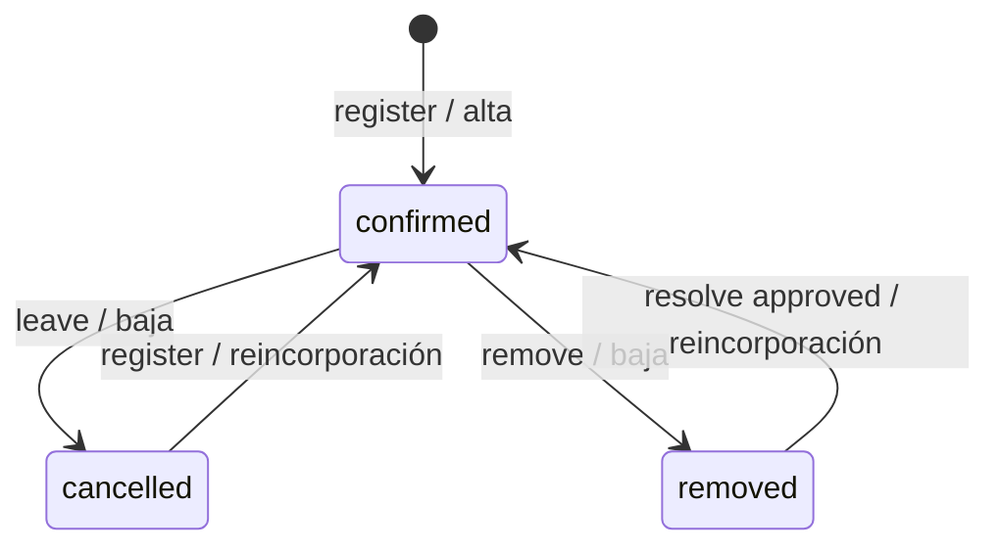

# Release 6 · Bloque 0 — Auditoría y contratos para revisión

**Adenda posterior B3 (15/10/2026):** el responsable aprobó exactitud actual con riesgo residual y D08. [Decisión y política vigente](RELEASE_6_BLOCK_3_DECISIONS.md) sustituyen el bloqueo D04 de este corte histórico; no constituyen firma integral de B0 ni autorización de B4.

**Corte:** 15/10/2026, Argentina. **Base integrada:** `ad9327fff5aca65e6b676a56f1e1e93737102f32`, PR #62. **Rama:** `codex/r6-block-0`. **Estado:** Implementado; QA y firma humana pendientes. **0/24 CA aceptados.** Documento completado según la plantilla B0; no implementa B1. Firma técnica: Codex, 15/10/2026; firma del responsable: **PENDIENTE**, no atribuida por el agente.

## 1. Entorno y fuentes

Worktree nuevo desde `origin/main` después de fetch. Checkout inicial con modificaciones ajenas conservado. `.env.local` copiado byte a byte desde `mapbox-worktree` (main local), ignorado y no versionado. No se reseteó ese main local antiguo. [Evidencias y reproducción](../qa/r6-block-0/README.md).

Leídos AGENTS raíz, src, Supabase y diseño; PRODUCT, DESIGN, arquitectura/modelo, DESIGN_SYSTEM/UI_WORKFLOW, plan/estado/QA R5, prompt/plan/estado/decisiones/requisitos/aceptación/plan de pruebas R6 y plantilla B0. Skills Supabase, Postgres (RLS/locks) y Drive para lectura. Nueva lectura de [Planificación original](https://docs.google.com/document/d/1MUKoIG5TWZXwp6e3ZKHgiKtWU7NnwaE3S3PhUcjsPww/edit), última modificación reportada `2026-10-14T03:30:02.621Z`; **24 textos CA coinciden literalmente**, no sólo sus IDs. [Fuente extraída](../qa/r6-block-0/source.json), [traza literal a contratos/bloques](../qa/r6-block-0/traceability.json). Los 6 RF conservan alcance del catálogo oficial; los nombres técnicos de esta propuesta no son APIs existentes.

Git acredita merges #50–#60 y #61 (aceptación humana) en la historia de main. #60 está integrada en `47dfb8f`, #61 en `66e24d8`; el GO humano del 14/10 sigue vigente. No convierte los NOT RUN técnicos de R5 en PASS. Los enlaces históricos de B10 que dicen «PR en borrador» describen aquel corte, no el estado actual.

Lectura remota sólo `planit-v2` (`iepeqmvzjguwlhnecsdq`), PostgreSQL **17.11**. CLI **2.120.0**: migration list **30/30**, dry-run con `--skip-vault` **sin pendientes**. Catálogo en transacción READ ONLY/ROLLBACK, advisors sin aplicar recomendaciones. El CLI inicializa rol de conexión de plataforma; ninguna escritura de negocio, DDL, deploy, fixture remoto ni consulta al proyecto legado. Datos personales individuales no extraídos.

## 2. Mapa de tablas y datos

[catalog.json](../qa/r6-block-0/catalog.json) contiene columnas/tipos/nullability, PK/FK/CHECK/UNIQUE, índices, triggers, funciones/cuerpos/config/EXECUTE, políticas, grants de tabla y columna, buckets y publicación. **16 tablas públicas, todas con RLS; 82 funciones.** Columnas, constraints, índices, políticas, triggers, grants y funciones coinciden con el catálogo versionado R5 B10; la comprobación offline es reproducible. No demuestra que cualquier operación futura sea segura.

| Fuente real | Contrato e invariantes | Uso R6 |
| --- | --- | --- |
| events | id PK; organizer_id→profiles RESTRICT; capacity entero >0; starts_at/ends_at y marcas locales sin TZ; cancelled_at/archived_at preservan evento | Denominador actual, ownership y estado: archived > cancelled > ended > open |
| event_participations | id PK; event_id/user_id FK RESTRICT; UNIQUE(event_id,user_id); status confirmed/cancelled/removed; created_at/updated_at locales | Sólo confirmed cuenta; organizador no ocupa plaza; sin contador redundante |
| participation_history | id PK; participation_id/changed_by FK RESTRICT; previous_status nullable, new_status requerido; CHECK estados distintos; reason; created_at local | NULL→confirmed alta; cancelled/removed→confirmed retorno; confirmed→cancelled/removed baja |
| profiles | birth_date date opcional, sex nullable female/male/other; trigger rechaza nacimiento futuro; SELECT íntegro owner-only | Agregación privilegiada futura, nunca microdatos ni lectura directa del cliente |
| notifications | id PK UUID, recipient_id/event_id/conversation_id/actor_id FK RESTRICT; type texto, no enum cerrado; título/cuerpo acotados; created_at/read_at locales | event_full cabe sin cambiar CHECK; sólo destinatario puede leer y marcar read_at |
| event_access_grants / links | Grant de detalle independiente de participación, restricciones de visibilidad en servidor | No dan permisos analíticos ni demográficos |

Discrepancia documental: la lista de **19 tablas** en `docs/database.md` incluye modelo objetivo (`stories`, `message_attachments`, `push_subscriptions`); no existen en catálogo actual. No crearlas por esa enumeración. Sin migraciones R6 en Git/remoto. No hay analítica owner-only R6 instalada; summary existente tiene audiencia más amplia.

Calidad: [consulta global protegida](../qa/r6-block-0/data-quality-readonly.sql) y [resultado](../qa/r6-block-0/data-quality.json) informan sólo totales globales ≥5 y suprimen los restantes. No se descargaron DOB/sex, IDs ni nombres reales. Opcionalidad implica faltantes; una muestra global no certifica completitud por evento ni exactitud declarada de edad/sexo. No inferir valores suprimidos como cero. Fixtures pequeños/adversariales son exclusivamente JSON sintético local. No se certifica cumplimiento legal; falta revisar consentimiento, finalidad y retención del uso demográfico antes de habilitarlo.

### Transiciones, rutas y locks reales

| RPC real | Locks/validaciones y efecto | Historial / episodio lleno |
| --- | --- | --- |
| register_for_event(uuid)→void | READ COMMITTED; evento FOR UPDATE; usuario desde auth.uid; detalle unlisted autorizado; no organizador, cerrado, sin cupo ni removed; confirmed retorna sin DML | INSERT nuevo o cancelled→confirmed activa trigger; retry confirmed no genera historia |
| leave_event(uuid)→void | READ COMMITTED; evento→UPDATE propia participación; can_view_event; admite retiro después de cierre | confirmed→cancelled; cancelled/removed no-op; acceso revocado a oculto puede denegarlo |
| resolve_rejoin(uuid,uuid,text)→void | evento→participación→solicitud; owner; pendiente/removed; aprobación verifica cupo/cierre/grant activo unlisted | approved produce removed→confirmed y rejoin_approval; rejected sólo cambia solicitud, sin historia de participación |
| remove_participant(uuid,uuid)→void | evento→participación; owner, vínculo evento, vigente; confirmed requerido | confirmed→removed, reason organizer_removal; retry removed no-op vigente |
| update_event(uuid,text,text,timestamp,timestamp,uuid,integer,text,float8,float8,text,text)→uuid | evento FOR UPDATE; owner; antes del inicio original; nuevo cupo ≥ confirmed; valida contenido/visibilidad | Sólo UPDATE events; **no** trigger de participación/historia; no aviso por editar capacity |



Trigger real `participations_record_history AFTER INSERT OR UPDATE OF status` invoca `planit_private.record_participation_history()`; escribe únicamente ante transición efectiva. `reason='registration'` también aparece al volver desde cancelled: **clasificar por previous/new_status, no por reason ni created_at de fila actual**. Historial no es stock ni auditoría de cupos. Cancelar/archivar evento, editar capacity, resolver rechazo y retries no generan transiciones de participantes. Índice de historia no garantiza orden causal para timestamps empatados: flujos cuentan transiciones sin replay arbitrario por UUID; no ofrecer ocupación histórica en R6.

Orden obligatorio futuro: evento→participación→solicitud (si existe)→historia→notificación, sin bloquear perfiles sociales en orden inverso. Conteo posterior al lock con snapshot READ COMMITTED; operaciones multi-evento futuras deben ordenar IDs si agregan locks. R6 de lectura no necesita locks de escritura.

`get_notification_target(uuid)→text` actual es INVOKER, recipient auth.uid, joins sujetos a RLS: follow_request→/me/follow-requests; DM→/messages/:id; evento→/events/:id; chat→/events/:id/chat. Mantener caso DM/follow, no reemplazar cuerpo por versión histórica. Frontend acepta ya el destino de detalle de evento; B7 agregará etiqueta, no URL arbitraria ni nuevo dock.

## 3. Matriz de permisos propuesta

| Operación R6 | A owner | B confirmed | C link-only/cancelled/removed | D ajeno, seguidor o bloqueado | anon |
| --- | --- | --- | --- | --- | --- |
| Ocupación/panel | Sí, todos sus estados | No | No | No | No |
| Demográficos | Sólo agregado seguro D04 | No | No | No | No |
| Series | Sí | No | No | No | No |
| CSV | Allowlist + mismo gate owner en cada consulta | No | No | No | No |
| Comparación | Todos los IDs propios; mixto rechaza completo | No | No | No | No |
| Aviso event_full | Sólo destinatario organizador | No | No | No | No |

Propiedad legítima no se pierde por bloqueo social, pero la **identidad individual en CSV respeta el enmascarado administrativo de R5**. No usar get_social_profile como fuente general de exportación. Perfil privado/accepted/DM/grant no amplían estadísticas. Tabla es contrato futuro: SQL/JWT R6 **NOT RUN**, no ACL ya instalada. Los controles existentes se comprobaron en catálogo; comportamiento remoto autenticado A/B/C/D no ejecutado.

Amenazas: UUID ajeno/inexistente con mismo error genérico; NULL auth.uid; lista mixta/duplicados/array nulo; offset/cursor manipulado; PII por notices/errores/logs/cache/Realtime; diferencias entre eventos y entre exportaciones; modificación de perfil/cupo/participación durante CSV; sesión/filtro que cambia durante fetch; fórmula CSV. No cachear respuestas privadas en SW ni reutilizar resultados entre identidades.

## 4. D01–D12 y precisiones propuestas

**A01–A07 permanecen aprobadas**, sin solicitar otra respuesta. Las precisiones siguientes son propuesta técnica del agente para firma; no se atribuyen al usuario ni habilitan consumidores.

| ID | Acuerdo conservado / precisión concreta | Estado y gate |
| --- | --- | --- |
| D01 | confirmed/capacity, available=max(capacity-count,0); porcentaje numérico sin redondear en RPC, UI 1 decimal; cap inválido→null + capacity_usable=false | Esencia aprobada; representación propuesta B1/B2 |
| D02 | Altas/reincorporaciones/bajas por transición; no stock histórico ni check-in | Aprobado; verificar historia en B4 |
| D03 | Inicial 30 días calendario AR incluyendo hoy; presets 7/30/90; UI fechas inclusivas→RPC [00:00 desde,00:00 día posterior hasta); max366 días; day/week, lunes; semana parcial rotulada, hasta54 buckets semanales para366 días | Propuesta para firma B4; corrige límite sugerido53 que pierde semanas parciales |
| D04 | k=5 mínimo propuesto; supresión de celdas 1..4, complementaria si total permite deducirlas; unknown también protegido; sin cruces, filtros ni desglose comparativo demográfico | **BLOQUEANTE B3/B5:** no garantiza anti-diferencias temporales/multievento; alternativas debajo |
| D05 | CSV confirmed actual: evento,username,nombre_visible,estado,fecha_primera_inscripcion; primera NULL→confirmed del historial o vacío si falta; bloqueado→username vacío/nombre Perfil no disponible | Categoría aprobada; columnas/masking propuestos para firma B5 |
| D06 | Dos CSV; estadísticas con evento,desde,hasta,granularidad,inicio_periodo,inscripciones_nuevas,reincorporaciones,bajas; UTF8 BOM, ;, CRLF, todo quoted y escape comillas; sin demografía hasta resolver D04 | Categoría aprobada; formato/límites propuestos B5 |
| D07 | Cada inscripción efectiva que completa cupo crea un aviso, rearma tras liberación; capacity edit sola no avisa | Aprobado, diseño transaccional sección5 para B6 |
| D08 | Edad en fecha local de consulta indicada en respuesta; bandas <18,18–24,25–34,35–44,45–54,55+ y sin informar; años cumplidos con age(fecha,DOB); 29/02 probar en SQL | Propuesta B3; sin DOB ni edad individual en respuesta |
| D09 | Propios públicos/ocultos, terminados/cancelados/archivados con estado explícito | Aprobado; selector debe incluir archivados expresamente |
| D10 | 2..10 IDs propios únicos; mezcla ajeno/inexistente falla completa; mismo cálculo actual | Aprobado B8 |
| D11 | Fetch al entrar, volver a foco y tras mutación propia; botón Actualizar; sin push del dashboard; Realtime sólo notificaciones; limpiar al cambiar identidad/evento/filtro y descartar respuestas obsoletas | Propuesta B2/B7 |
| D12 | R5 GO humano e integración confirmados; aplicación remota, deploy, merge y bloque siguiente son puertas independientes | Dependencia superada; B1 sigue NO autorizado |

**D04: conflicto no resuelto por k.** Total10 con celda visible9 revela la celda oculta1; ocultar otra celda evita esa resta en una tabla. Pero consultas [5,5] y [6,5] son ambas k-seguras y revelan el atributo de la única persona añadida; dos eventos con conjuntos casi idénticos producen lo mismo. Un owner que controla entradas y conoce la lista puede repetir ataques. También cambia DOB/sex o cumpleaños sin cambiar membresía. Por ello no afirmar seguridad sólo por k ni prometer cero inferencia con exactitud de agregados dinámicos.

Para aprobación antes de B3: elegir política con garantías explícitas, p.ej. publicación única de cohorte fija al cierre y control transversal de conjuntos solapados, o mecanismo de privacidad diferencial con presupuesto transversal (introduce aproximación y complejidad que requieren aprobación). Ambas necesitan diseño/pruebas y no garantizan automáticamente anonimato frente a conocimiento auxiliar. Mientras tanto respuesta demográfica **suppressed=true**, sin conteos ni unknown_count reveladores. No entregar permanentemente vacíos como cumplimiento de RF-R6-02: es un bloqueo de implementación/aceptación, no recorte silencioso. Esta precisión no bloquea técnicamente ocupación B1, pero requiere revisión humana de B0.

## 5. Contratos candidatos congelados para revisión

No se crea SQL de producto. Firmas propuestas sin sobrecargas, todas timestamp sin zona:

| RPC futura | Parámetros exactos | Retorno |
| --- | --- | --- |
| get_my_event_occupancy | p_event_id uuid | jsonb Occupancy |
| get_my_event_demographics | p_event_id uuid | jsonb Demographics; D04 impide habilitarla |
| get_my_event_participation_series | p_event_id uuid,p_from timestamp,p_to timestamp,p_bucket text | jsonb Series |
| get_my_event_export_rows | p_event_id uuid | jsonb Export, snapshot único; no cursor mutable |
| compare_my_event_occupancy | p_event_ids uuid[] | jsonb {as_of,events:Occupancy[]} |

Ejemplos de DTO (números sintéticos, timestamps AR):

```json
{"event_id":"uuid","title":"Fixture","event_state":"open","as_of":"2026-10-15T12:00:00","capacity":10,"confirmed_count":4,"available_spots":6,"occupancy_percent":40,"capacity_usable":true}
```

```json
{"as_of":"2026-10-15T12:00:00","age_as_of":"2026-10-15","suppressed":true,"reason":"privacy_policy_pending","age_groups":[],"sex_groups":[],"unknown_count":null}
```

```json
{"from":"2026-10-01T00:00:00","to":"2026-11-01T00:00:00","bucket":"day","points":[{"bucket_start":"2026-10-01T00:00:00","new_confirmations":1,"reconfirmations":0,"departures":0}]}
```

D04 final definirá nulls y suppression por dimensión/celda. Nunca enviar conteo oculto ni porcentajes/total de dimensión que lo reconstruyan. Rangos afectan **sólo Series/CSV estadístico**, no ocupación actual ni demografía; UI lo rotula. Series rellena buckets vacíos con cero únicamente cuando consulta tuvo éxito, no ante error. Rechazar NULL, fechas no finitas, from≥to, >366 días, bucket ajeno; week puede intersectar límites sin incluir historia fuera de [from,to).

RPC de lectura STABLE DEFINER justificada por RLS owner-only de perfiles/participaciones: auth.uid no nulo, verificar owner **antes** de leer agregados; search_path vacío y todos los nombres calificados. REVOKE EXECUTE PUBLIC/anon, GRANT authenticated exclusivamente; ninguna nueva lectura general de profiles/history ni grants de escritura. Errores 42501 authentication_required/event_unavailable; parámetros inválidos22023; no payload parcial ni IDs ajenos en errores. Tests directos HTTP reales de B1 verifican privilegios, no se sustituyen por RequireAuth.

**Exportación coherente:** paginar filas actuales con cursor estable evita duplicados pero no mezclas de snapshots mientras cambian estado/nombres. Propuesta mínima: una única RPC, una sentencia de snapshot, máximo **5.000 filas / 10MiB UTF8** de payload exportable, límite comprobado en servidor y cliente, timeout15s. Superado→export_too_large sin filas; no truncar. Export DTO {as_of,event_title,rows:[{username,display_name,status,first_registered_at}]}. No exportar UUIDs ni columnas privadas. No datos→mensaje explícito sin archivo vacío engañoso. Si se exige mayor volumen en B5, diseñar snapshot/paginación real o Edge autenticada antes de cambiar firma; no inventar token de snapshot sin persistencia/contrato.

Stats CSV usa exactamente respuesta Series del rango activo, no agrega demográficos inseguros. Sanitizar cada celda textual antes del quoting: detectar =,+,-,@ tras whitespace/control, prefijar apóstrofo, cubrir tabs/CR/LF y Unicode; fechas ISO local sin Z. Limpiar nombre archivo y no producir Blob hasta completar validación, autorización, tamaño y serialización. Probar parser round-trip, lector externo y cambios de sesión. Límites propuestos requieren benchmark local B5; no SLA ya probado.

**event_full:** proponer productor privado sobre INSERT de participation_history, no dos AFTER triggers de participación con orden alfabético implícito. Invocado bajo transacción autorizada que ya bloqueó evento, new_status=confirmed y previous_status distinto; count confirmado posterior=capacity implica antes count-1<capacity. INSERT notifications con `id=history.id`, recipient=organizer, event_id, type=event_full, título/cuerpo genéricos sin persona. PK de notification deduplica la misma transición y no bloquea episodios futuros; no hace falta tabla de contadores ni UNIQUE(event_id,type). Un conflicto incompatible debe abortar, no ocultarse con DO NOTHING indiscriminado. Nuevo UUID de historia para nuevo episodio; retries no insertan historia. Fallo aviso revierte participación+historia. Simultáneas serializadas por evento; B6 prueba última plaza, retorno, libre→lleno, rollback, edición capacity y closed/unlisted. No deducir garantía de privilegios a partir de que el trigger es privado: revocar EXECUTE y verificar que toda escritura legítima entra por RPC.

**Comparación:** mismo agregado que occupancy en una consulta, autorizar TODOS los IDs antes de responder, rechazar duplicados, NULLs, multidimensionales y cardinalidad fuera2..10; resultado orden de selección vía ordinality. Cap>0 actual; fixture DTO inválido devuelve N/D, nunca divide por cero. get_my_organized_events('all') **excluye archivados**: B8 debe combinar lectura autorizada de archivados y deduplicar, o justificar RPC de selector. No usar sólo 'all' y afirmar A06 cumplida.

Índices existentes suficientes para evaluar B1: events_organizer_idx; participations_event_status_idx(event_id,status); UNIQUE(event_id,user_id); participation_history_participation_created_idx(participation_id,created_at). Sin índices adicionales por intuición. B1/B4 medir EXPLAIN ANALYZE BUFFERS en replay local 0/1/10/100/1000 participantes y10 eventos; benchmark NOT RUN en B0, sin carga remota. Comparación una consulta set-based, no N+1 ni un SELECT por día. Objetivo p95<300ms es hipótesis de prueba, no SLA aceptado.

Responsabilidades: SQL autoriza/calcula/suprime; `features/analytics` futuro valida DTO y serializa CSV; páginas futuras presentan filtros/errores/contexto sin autoridad de seguridad. Mantener R3 y R5 intactos. Reversión futura: ocultar entrada/ruta y revocar nuevas RPC mediante migración incremental autorizada; deshabilitar productor sólo con plan explícito, conservar avisos/historia y no tocar migraciones aplicadas.

## 6. Diseño visual y QA

Mockup original `docs/design/mockups/release-6.png` inspeccionado y conservado (hash en audit.json): ocupación, métricas, períodos, reportes, comparación. **Ningún pixel ni archivo visual modificado en B0.** Dirección vigente Amanecer; mantener referencias originales como inventario funcional, sin introducir nuevas funciones por ilustración. B2 ruta /events/:id/analytics desde gestión, B8 /my-events/compare; cuatro pestañas actuales y retorno preservado. Reusar ScreenHeader/StatusMessage/tokens --pi-*. Gráficos con tabla/texto, carga/error/retry/sin datos/supresión, teclado/zoom200% y seis anchos según plan. No screenshots de UI inventada ni afirmar QA visual en una entrega sin UI.

Reutilizar harness SQL real de `check-r5-social.mjs` para replay/roles/concurrencia y `check-r5-regressions.mjs`, suites R1–R4 de inscripciones/rejoin/attendees. HTTP R5 distingue pruebas anónimas de JWT reales; B1 requiere cuentas A/B/C/D autorizadas. Build/lint y auditoría B0 registrados en README. R6 SQL-local/JWT/UI/Realtime/PWA, benchmarks y dispositivos: **NOT RUN**, pues R6 aún no existe. Fixtures de amenaza JS sólo acreditan contraejemplos matemáticos, no permisos remotos ni solución demográfica.

## 7. Gate y firma

**Auditoría B0 entregada; NO-GO para avanzar automáticamente.** Dependencia Git/catálogo disponible para B1 tras aprobación humana; no se requiere resolver D04 para calcular ocupación, sí antes de B3 y cualquier CSV demográfico. Revisar esta propuesta concreta D01/D03–D06/D08/D11, diseño de exportación/aviso y riesgo anti-diferencias. No marcar CA PASS, firmar como usuario ni modificar Google Docs por esta entrega. Firma humana y permiso B1 **PENDIENTES**.

Migraciones B0: **creadas0 / probadas locales nuevas0 / aplicadas remotas0 / verificadas remotas nuevas0**. Lectura del catálogo de30 históricas no es aplicación ni replay local nuevo. Sin cambios funcionales, publicación ni deploy. SHA final y enlace PR se registran en bitácora de evidencia; commits de seguimiento no alteran baseline funcional.
