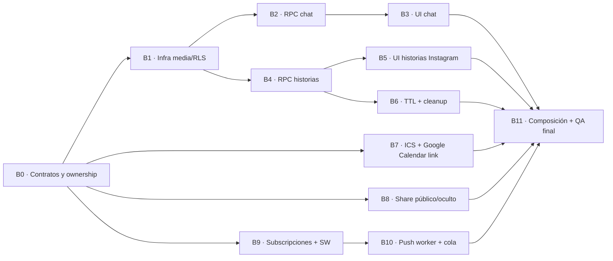

# PlanIt — Release 7 · Ejecución paralela, ownership y estrategia de integración

**Versión:** 2.0 · 15/10/2026. **Objetivo:** permitir mínimo dos implementadores simultáneos, sin exigir ejecución B0→B11 estrictamente secuencial. **Referencia:** `RELEASE_7_PLAN.md`, `RELEASE_7_DECISIONS_PROPOSED.md` y 12 prompts individuales. **B0 es una sincronización breve, no un sprint entero de bloqueo.** R6 se presupone completa para el diseño.

## 1. Grafo de dependencias real (DAG)



**Criterio para desbloquear:** contrato aprobado y **base de código integrada en rama compartida**, no «el desarrollador anterior dice que terminó». Un bloque puede empezar antes preparando pruebas/componentes aislados sobre interfaces mockeadas, pero no puede reclamar QA de integración sin el predecesor. **B6 depende de B4 (no de B5)**: el cron puede desarrollarse mientras otra persona crea el visor.

## 2. Ventanas de paralelismo

| Ola | Trabajos ejecutables sin esperar otros de la misma ola | Gate real |
|---|---|---|
| **Ola 0** | B0: auditoría, acta de decisiones, contrato de APIs, reserva de archivos | revisión humana B0; ramas de feature desde base común |
| **Ola 1** | **B1** (media/RLS), **B7** (calendario), **B8** (share), **B9** (Push SW + subscriptions) | B1 requiere integración antes de B2/B4; B9 antes de B10 |
| **Ola 2** | **B2** (RPC chat) y **B4** (RPC historias), independientemente; **B10** (Push worker) | B1 y B9 integrados en las ramas consumidoras según la dependencia |
| **Ola 3** | **B3** (UI chat), **B5** (visor Instagram) y **B6** (TTL/cleanup) en paralelo; B7/B8/B10 pueden seguir su evolución | B2 para B3; B4 para B5 y B6 |
| **Ola 4** | **B11**: composición de pantallas comunes, migraciones coordinadas, QA y regresión | todos los productores integrados; GO/NO-GO separado |

No hace falta esperar que **toda la ola** termine para iniciar un sucesor: B4 puede empezar apenas B1 se integre, aunque B9/B7 todavía estén en desarrollo.

## 3. Asignación recomendada para dos personas

| Etapa | Persona A | Persona B | Condición |
|---|---|---|---|
| Inicio | B0 (contratos media, permisos) | B0 (contratos Push, UI, calendario) | cerrar acta B0 entre ambos |
| Primer paralelo | **B1** media/Storage | **B9** Push/SW/subscriptions | independientes |
| Segundo paralelo | **B2** API chat | **B4** API historias | al terminar e integrar B1; si B9 no terminó, B puede cerrar B9 primero |
| Tercer paralelo | **B3** UI chat, luego **B7** calendario | **B5** visor historias; **B6** cleanup | B6 inicia tras B4, simultáneo con B3/B5 |
| Resto | **B8** share | **B10** worker Push (tras B9) | sin tocar `EventDetailPage.tsx` |
| Integración | **B11** composición y regresión UI | **B11** seguridad DB/Push y QA | PR integradora coordinada, un dueño del merge |

Este cuadro es una **propuesta de staffing**, no impone que B4 espere B9. Para maximizar paralelismo, cada persona toma el siguiente bloque **desbloqueado** de otra área cuando se libera.

### Con tres o cuatro personas

- **A — Chat/media:** B1 → B2 → B3.
- **B — Historias:** prepara viewer aislado B5 sobre interfaces ficticias tras B0, luego B4 (espera integración B1), B5 definitivo y B6 (se puede dividir con C).
- **C — Integraciones web:** B7 + B8 en paralelo si hay dos ramas; si es una persona, sucesivamente, sin dependencia de B1.
- **D — Notificaciones:** B9 → B10 sin depender de multimedia.

B11 se reparte en pruebas por dominio, pero **una sola persona** tiene ownership del PR integrador y de los archivos compartidos.

## 4. Contratos y ownership de archivos, para reducir conflictos

| Bloque | **Dueño exclusivo (puede escribir)** | **Debe tratar como sólo lectura durante la ejecución paralela** |
|---|---|---|
| B0 | Documentación de acuerdos y contratos; NO migraciones ni componentes de features | Código R6 y `main` |
| B1 | `supabase/migrations/*_r7_media_contract.sql`; helpers nuevos `src/features/events/media/*` si se aprueban | `src/pages/*`, migraciones históricas, `vite.config.ts` |
| B2 | `supabase/migrations/*_r7_chat_attachments.sql`; tests SQL/RPC específicos chat | `src/pages/EventChatPage.tsx`, `src/pages/EventDetailPage.tsx`, `src/App.tsx` |
| B3 | `src/pages/EventChatPage.tsx`, su CSS y **adaptador** de lectura/escritura `src/features/events/chat.ts` | `EventDetailPage.tsx`, `src/App.tsx`, migraciones B1/B2 |
| B4 | `supabase/migrations/*_r7_stories.sql`, backend RPC y API aislada `src/features/events/storiesApi.ts` | `EventDetailPage.tsx`, `src/App.tsx`, migración de B1 |
| B5 | `src/pages/EventStoriesPage.tsx` o `src/features/events/stories/*`, CSS/visor `StoryViewer`, pruebas UI | `EventDetailPage.tsx`, `src/App.tsx`, B4 migrations |
| B6 | `supabase/functions/r7-media-cleanup/**`, migración **nueva** de job/índices de cleanup y tests TTL | migración B4, UI historias, funciones Push |
| B7 | `src/features/events/calendar.ts`, `src/features/events/EventCalendarAction.tsx`, tests | **NO editar** `EventDetailPage.tsx`, `src/App.tsx` ni helpers `share.ts` |
| B8 | `src/features/events/share.ts`, `src/features/events/EventShareAction.tsx`, tests | **NO editar** `EventDetailPage.tsx`, `src/App.tsx` ni calendar.ts |
| B9 | `vite.config.ts`, `src/sw.ts`, `src/features/notifications/push.ts`, migración **propia** subscription, componente `PushSettings` | `NotificationsProvider.tsx`, `src/App.tsx`, Edge worker B10 |
| B10 | `supabase/functions/r7-push/**`, migración **nueva** push queue, tests envío | `src/sw.ts`, `vite.config.ts`, trigger/R5/R6 históricos, inbox frontend |
| B11 | `src/pages/EventDetailPage.tsx`, `src/App.tsx`, ubicación real de ajustes Push, docs QA/STATUS finales y ajustes de integración justificados | no reabrir lógica de dominio sin PR corrector explícito |

**Regla:** el hecho de que un prompt liste un archivo para **auditar** no concede permiso de edición. Si una modificación compartida es inevitable, abrir un ticket de contrato y asignar **único integrador**; el feature entrega componente/API desacoplado y **B11 lo conecta**. Evita tres PR simultáneas alterando botones de la ficha de evento.

**Contratos congelados antes de paralelizar:**

1. **Media contract:** namespace privado separado para `r7/chat` y `r7/stories`; `image/jpeg,image/png,image/webp`, tamaño <= 5 MiB, uploads inmutables, `file_id` y `attempt_id`, regla de acceso por evento/participación y tiempo según tipo.
2. **Chat:** interfaz de envío con `eventId`, `messageId` idempotente, body opcional, `fileId` opcional; **al menos uno presente**; máximo una imagen. `kind='direct'` prohíbe `fileId` y exige texto. La RPC final y tipos se registran en B0.
3. **Historias:** `eventId`, `storyId`, `fileId`, `createdAt` y `expiresAt=createdAt+24h` desde DB; GET autorizado a tiempo real; se permite lectura tras fin normal, no publicación nueva; API entrega lista por evento ordenada y sin leaks. Story viewer consume **tipos acordados**, no tablas directamente.
4. **Calendar/Share:** B7 exporta `EventCalendarAction`; B8 exporta `EventShareAction`; ambos reciben un DTO **de evento autorizado y sanitizado**, no consultan listados privados de asistentes. Google mediante URL template + ICS; compartir oculto sólo organizer y sólo invite URL válida.
5. **Push:** B9 exporta `PushSettings`, registro SW y preferencias preview; B10 consume `notification_id`/`subscription_id`, sin acoplar UI. Push DM ofrece preview real para destinatario; no pushes por mensaje grupal.
6. **Integración:** B11 importa los tres entrypoints (`EventStoriesEntry`, `EventCalendarAction`, `EventShareAction`) y `PushSettings` y es único dueño de wiring central/routing hasta merge final.

## 5. Convención de ramas y worktrees

Cada tarea en **rama/worktree separados**, nunca dos Codex editando la misma copia de trabajo. Ejemplo:

```bash
# Cada persona desde main actualizado antes de su primer bloque
 git fetch origin
 git worktree add ../PlanIt-r7-b1 -b feat/r7-b1-media origin/main
 git worktree add ../PlanIt-r7-b9 -b feat/r7-b9-push origin/main
```

Cuando B1 sea aprobado e integrado, B2 y B4 **ambos** parten del nuevo `main` (o de una rama de integración explícita) y no dependen entre sí:

```bash
 git fetch origin
 git worktree add ../PlanIt-r7-b2 -b feat/r7-b2-chat origin/main
 git worktree add ../PlanIt-r7-b4 -b feat/r7-b4-stories origin/main
```

Sugerencia de ramas: `feat/r7-bN-short-name` (o `codex/r7-block-N`, consistente con convención R6). PR draft, CI y revisión por bloque; **no** merge automático por Codex. El integrador decide orden y ejecuta suites reales.

## 6. Migraciones Supabase: paralelas en desarrollo, serializadas en integración

**B1/B2/B4/B9/B10/B6 pueden escribir migraciones nuevas distintas en paralelo**, pero todos acuerdan número/orden antes de integrarlas. Evitar crear timestamps futuros a ojo o modificar la misma migración histórica. Reservar slots lógicos en B0, por ejemplo B1 media, B2 chat, B4 stories, B9 subscriptions, B10 jobs, B6 GC; los nombres definitivos y `version` se fijan según el árbol real al integrar.

- Si el orden físico de ficheros obliga B9 entre B2/B4, validar replay completo desde cero tras merge; no confiar en replay individual. Si un cambio exige R7-B1 y R7-B4, la migración B4 **sólo** se integra luego de B1.
- No aplicar migraciones remotas individualmente desde ramas no integradas. Gate humano independiente antes de cada despliegue a `planit-v2`; proyecto legado sólo lectura.
- DB local por worktree **aislada o gestionada** (puertos y volúmenes separados) para no mezclar versiones. Nadie corre `supabase db reset` o cambia esquema remoto en entorno compartido por sorpresa.
- PR B1 debe demostrar que Storage RLS no deja bypass por otras policies; PR B4/B6 comprueban T+24h exacto sin depender del cron.
- El worker y cleanup usan funciones Edge separadas; los secretos (VAPID, tokens scheduler) se configuran después de revisión del integrador, no en repositorio.

## 7. Contrato de integración continuo

1. **Inicio:** B0 publica `RELEASE_7_BLOCK_0_DECISIONS_TEMPLATE.md` resuelta, DTOs y firmas API, matriz de permisos, freeze de rutas compartidas y tablas nuevas.
2. **Antes de abrir PR:** desarrollador hace `git fetch`/rebase o merge desde base vigente; compara interfaces; corre pruebas del bloque; redacta changelog de ruptura y migración. Si cambian tipos compartidos, notifica a consumidores **antes del merge**.
3. **Review cruzada:** otro implementador revisa seguridad/contrato. No dos merges al mismo tiempo sobre RLS/SQL; un integrador controla secuencia.
4. **Post-merge de cada bloque:** build/lint, SQL local replay si hay migración, regresión de chat/DM/Storage/notifications según alcance. Actualizar matriz de dependencias y desbloquear sólo sucesores concretos.
5. **B11:** conecta componentes desacoplados en `EventDetailPage.tsx`/`src/App.tsx`, valida rutas, hooks, permisos, navegación, prueba Push con navegador real, 29 CA, documentación y acta humana. Resolver conflictos **antes** de marcar PASS.

### Política de conflictos

- **Conflicto de tipos/API**: mantener la firma congelada o proponer cambio versionado con aprobación; no hacer `any` ni desactivar TS.
- **Conflicto UI**: el bloque productor no edita ficha del evento; B11 hace wiring en un solo PR.
- **Conflicto migración**: nueva migración correctiva, nunca reescribir historial aplicado; confirmar orden/replay.
- **Conflicto policy Storage**: revisión de seguridad central del integrador; tests para uploader, confirmado, removido, link-only y anon.
- **Conflicto estado QA**: cada bloque entrega evidencia aparte y **B11 es el único que actualiza la matriz final**, sin atribuir ejecución de otros.

## 8. Matriz de responsabilidad

| Riesgo/transversal | Responsable principal | Revisor |
|---|---|---|
| Contratos/decisiones B0 | líder técnico | 2.º implementador |
| DB/RLS y Storage de historias | B1/B4/B6 | implementador de Push/QA |
| Chat y regresión DM | B2/B3 | implementador historias |
| Experiencia Stories Instagram | B5 | UX/implementador chat |
| `.ics` y Google Calendar link | B7 | integrador B11 |
| Eventos ocultos/Share | B8 | revisor R4/DB |
| Service Worker, preview Push y Edge jobs | B9/B10 | revisor seguridad |
| `EventDetailPage`, rutas y merge final | B11 único | resto del equipo |

## 9. Definición de «bloque independiente terminado»

Un bloque puede marcarse **LISTO PARA INTEGRAR** si: su diff respeta ownership; API coincide contrato B0; tests unitarios/SQL locales y negativos PASS; migraciones fueron ensayadas, no supuestas; `build/lint` ejecutados cuando aplique; PR draft con base SHA y evidencias; y no hubo cambios remotos no aprobados. Eso **no es QA R7 final**. Los 29 CA siguen NOT RUN hasta que existan pruebas integradas verificadas.